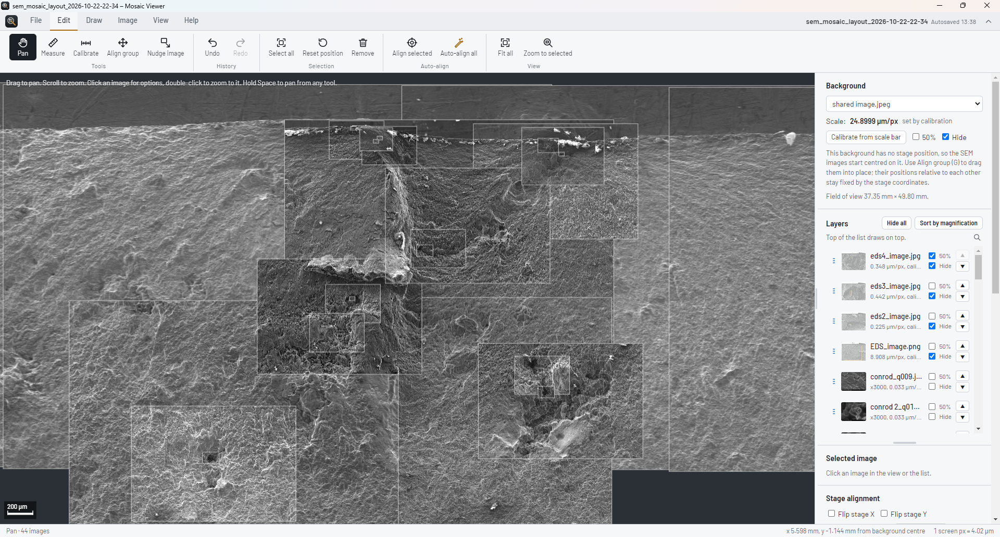

# Mosaic Viewer

Mosaic Viewer turns many overlapping images into one map you can zoom, measure and mark up.

It was built for SEM fracture surfaces. If an SEM image comes with its `.txt` file, the app reads the scale and stage position and puts the image in place for you. Any other image with a scale bar (microscope images, photos) works too: you calibrate it and place it by hand.




## Download

1. Open the [latest release](https://github.com/harrisoncroft52/mosaicviewer/releases/latest).
2. Download `Mosaic-Viewer-Setup-x.y.z.exe` and run it.
3. Windows may say it "protected your PC", because the app isn't code-signed. Click **More info**, then **Run anyway**.

It installs for your user only, so you don't need admin rights. After that, the app updates itself: when a new release is out it shows a card with what changed, downloads the update in the background and installs it on restart.

Windows 10 or 11, 64-bit.

## Quick start

1. **New project**, then **Import images** (`Ctrl+I`). Select the images and their `.txt` files. If a `.txt` sits next to its image on disk, it's found automatically.
2. Optional: pick an overview photo as the **Background** in the side panel. **Calibrate** it from its scale bar, then drag all the images onto it with **Align group**.
3. **Edit → Auto-align all** (`Ctrl+Shift+L`) matches the overlaps and fixes the positions.
4. Measure, annotate, adjust, then **Save** (`Ctrl+S`) or **Export PNG** (`Ctrl+E`).

Press `F1` in the app for the full guide and every shortcut.

## Features

- **Placing images**: automatic from SEM stage data, or by hand with Nudge. Layers, transparency, search and sorting by magnification. (Figure shows images immediately after import)


- **Auto-align**: matches every overlapping pair and solves all positions together.
  - High-magnification images are trusted most.
  - Each lens mode gets its own offset.
  - It corrects low-magnification frames whose pixel size is off.

- **Measuring**: distances, areas with perimeter, and angles.
- **Drawing**: text, arrows, lines, circles, rectangles and a freehand pen. Drawings stay pinned to the features they mark.
- **Image tab**:
  - brightness and contrast, plus one-click "Match images" to even out frames
  - opacity, blend modes, and a Difference mode for checking alignment
  - feathered edges to hide seams
  - bookmarked views
- **Projects**: the home screen lists recent projects, and AutoSave keeps a recovery copy if the app closes unexpectedly. Layouts can include the images or link to them.
- **Export**: PNG of the view, the whole mosaic or just the selection, or copy the view straight into a report.
- Light and dark mode, and more than 80 keyboard shortcuts.


## Save files

Layouts are plain `.json` files. Their format is shared with the original browser version of the viewer, so either one can open the other's files.

## Building from source

You need [Node.js](https://nodejs.org) 20 or newer.

```
npm install
npm start                                       # run the app
npx electron-builder --win --x64 --publish never   # build the installer into dist/
```

To release a version:

1. Raise `version` in `package.json` and build.
2. Create a GitHub release tagged `v` plus that version, for example `v1.2.0`.
3. Attach these three files from `dist/`: the installer `.exe`, its `.blockmap`, and `latest.yml`.

The installed apps pick up the release on their next start.

## Feedback

Found a bug or have an idea? Use the [feedback form](https://forms.gle/eiDcu5BbTDVvtWJP9), or the **Send feedback** button in the app.

## Author

Made by Harrison Croft, mechanical engineering, Auckland University of Technology.
